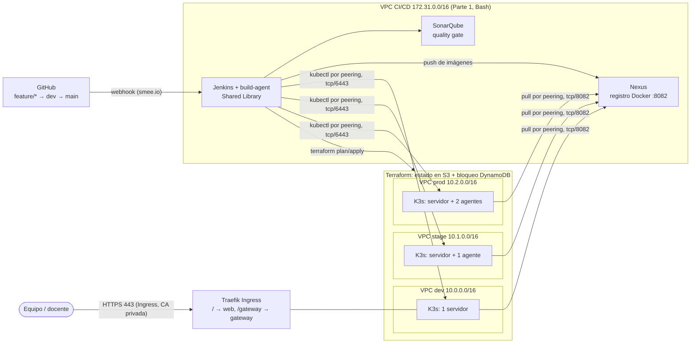

# CircleGuard Monorepo

**Absolute Privacy. High-Speed Containment. Secure Campus.**

CircleGuard is a state-of-the-art university contact tracing and fencing system designed to identify interconnected contact groups ("Circles") and apply rapid health fences while preserving individual anonymity.

> **Sobre este repositorio.** CircleGuard es un producto preexistente: sus microservicios, su cliente Expo y su visión funcional pertenecen al proyecto original. Este monorepo se usa como base del **Proyecto Final de Ingeniería de Software V (Universidad Icesi, 2026-2)**. El equipo del curso **no es autor de los microservicios originales**. Su aporte es dotar al producto de infraestructura reproducible en AWS, empaquetamiento Docker, un pipeline CI/CD en Jenkins, análisis de calidad con SonarQube, pruebas automatizadas y despliegue entre ambientes (Parte 1) y, en la Parte 2, infraestructura como código con Terraform, Kubernetes (K3s) por ambiente, seguridad, observabilidad, patrones de diseño y pruebas avanzadas.
>
> **Cómo leer este README.** Las secciones conservan tres capas: el **producto original**, la **intervención DevOps de la Parte 1** (Docker Compose sobre seis EC2, Sprints 0 y 1) y la **intervención DevOps de la Parte 2** (Terraform y K3s, Sprint 2). Cada procedimiento indica a cuál pertenece. Resumen ejecutivo en inglés: [`docs/executive-summary-part-2.md`](docs/executive-summary-part-2.md).

---

## Tabla de contenido

1. [Presentación y propósito](#1-presentación-y-propósito)
2. [Arquitectura y tecnologías](#2-arquitectura-y-tecnologías)
3. [Estructura del repositorio](#3-estructura-del-repositorio)
4. [Requisitos previos](#4-requisitos-previos)
5. [Desarrollo local](#5-desarrollo-local)
6. [Infraestructura AWS: encendido, apagado y verificación](#6-infraestructura-aws-encendido-apagado-y-verificación)
7. [Acceso a Jenkins](#7-acceso-a-jenkins)
8. [Reproducción y configuración de Jenkins](#8-reproducción-y-configuración-de-jenkins)
9. [Funcionamiento del pipeline CI/CD](#9-funcionamiento-del-pipeline-cicd)
10. [Despliegues, validación y rollback](#10-despliegues-validación-y-rollback)
11. [Solución de problemas y limitaciones](#11-solución-de-problemas-y-limitaciones)
12. [Parte 2: seguridad, observabilidad, pruebas y costos](#12-parte-2-seguridad-observabilidad-pruebas-y-costos)
13. [Referencias](#13-referencias)

---

## 1. Presentación y propósito

### 1.1 Producto original

#### Vision & Mission

Our vision is a university campus where health containment speed outpaces lab confirmation timelines without compromising student privacy. CircleGuard leverages campus-native intelligence—class schedules and WiFi infrastructure—to deliver a human-validated, graph-based protection ecosystem.

#### Key Differentiators
- **Privacy-as-Code**: Zero real-name exposure outside a secure Health Center vault.
- **Recursive Containment**: Status promotion cascades (Suspect → Probable → Confirmed) that trigger in milliseconds.
- **Campus Integration**: Smart check-ins using existing WiFi AP triangulation and Bluetooth Low Energy (BLE).

#### Success Metrics (product targets)

> Objetivos definidos por el producto original:

| Metric | Target | Measurement |
|:---|:---|:---|
| **Containment Speed** | < 60 Seconds | Automated test of promotion engine cascade |
| **Privacy Compliance** | 100% Anonymity | Penetration test on graph database (Zero real names) |
| **Check-in Adoption** | > 70% | Analytics on scheduled class contact validation |
| **False Positive Rate** | < 15% | Post-fence surveys of actual vs. suspected contact |
| **System Uptime** | 99.5% | 7:00 AM – 10:00 PM (Academic Peak Hours) |

#### Product Roadmap (original)

> Hoja de ruta funcional del producto original, que se conserva como referencia. No forma parte del alcance DevOps del curso.

**Phase 1: MVP — The Intelligence Core**
- [x] Status Promotion Machine (Suspect → Probable → Confirmed).
- [x] Temporal graph with 14-day TTL edges.
- [x] Multi-channel fence notifications (Push/Email/SMS).
- [ ] Health Center de-identification console.

**Phase 2: Growth — Spatial Intelligence**
- [ ] WiFi AP triangulation integration.
- [ ] Campus entry validation (Gatekeeper) QR integration.
- [ ] LMS integration for "Remote Attendance" status automation.

**Phase 3: Vision — Full Ecosystem**
- [ ] Off-campus circle detection via P2P Bluetooth.
- [ ] Global Health Dashboard with hotspot visualization.
- [ ] Lab API bridge for automated test result ingestion.

### 1.2 Intervención DevOps — Parte 1 (Sprints 0 y 1)

El equipo de Ingeniería de Software V añadió al producto base lo siguiente:

| Entregable | Qué se agregó |
|:---|:---|
| E1.1 Gestión ágil | Scrum en Jira, Product Backlog, GitFlow simplificado (`feature/*` → `dev` → `main`), rulesets en GitHub, plantilla de PR y validación de Conventional Commits. |
| E1.2 Infraestructura | Seis instancias EC2 (Jenkins, SonarQube, Nexus, `dev`, `stage` y `prod`), aprovisionadas y configuradas con scripts Bash idempotentes en `infra/`. |
| E1.3 Empaquetamiento | Dockerfiles multi-stage sin root para los 8 servicios y el cliente web, imágenes versionadas y publicadas en Nexus, y Docker Compose por ambiente con healthchecks. |
| E1.4 Pipeline CI | Job multibranch en Jenkins con Shared Library, ejecución selectiva por unidad, pruebas, quality gate de SonarQube, empaquetado y publicación. |
| E1.5 Entrega continua | Despliegue automático a `dev` y `stage`, aprobación manual para `prod` y rollback automático cuando el despliegue falla. |
| E1.6 Pruebas | Cobertura JaCoCo con quality gate de líneas ≥ 60 %, pruebas de integración con Testcontainers y tres flujos E2E con Playwright. |
| E1.7 Cambios y release | Proceso de gestión de cambios, versionado SemVer y generación de release notes con `infra/release/`. |
| E1.8 Documentación | Este README, las guías de `infra/` y `docs/`, el informe de la Parte 1 e `IAG_REGISTRO.md`. |

### 1.3 Intervención DevOps — Parte 2 (Sprint 2)

Hasta el cierre de la Parte 1 esta sección se titulaba «Previsto para la Parte 2». La tabla describe lo implementado y el estado de su verificación; el detalle está en la [matriz de cumplimiento](docs/matriz-cumplimiento-parte-2.md).

| Entregable | Qué se agregó | Estado de la verificación |
|:---|:---|:---|
| E2.1 Terraform (TEC-09, HU-10) | Siete módulos (`network`, `compute`, `registry`, `storage`, `observability`, `cicd_link`, `finops`), tres ambientes por variables, estado en S3 con bloqueo en DynamoDB, diagramas. | Aplicado en AWS; `terraform plan -detailed-exitcode` = 0 en dev, stage y prod. |
| E2.2 Kubernetes (HU-11, HU-12) | K3s en EC2 (1, 2 y 3 nodos), Kustomize base + overlays, los 8 servicios, web y 6 middleware, ConfigMaps, Secrets, Ingress con TLS, HPA y sondas. | 15 workloads listos por ambiente; HPA probado en dev. |
| E2.3 Pipeline (HU-13) | Trivy (secretos, IaC, imágenes), Kubernetes Preflight, Terraform plan/apply, despliegue K3s, E2E, promoción, aprobación a prod y webhook de fallos. | Controles bloqueantes ejecutados en Jenkins (builds #46 a #51 de `dev`); el recorrido completo hasta K3s desde el pipeline está pendiente (sección 9.4). |
| E2.4 Patrones (HU-14 a HU-16, TEC-10) | Circuit Breaker + Retry (Resilience4j), configuración externa + feature toggle, cache-aside con Redis; 11 patrones existentes documentados. | Pruebas con falla inyectada en verde. |
| E2.5 Observabilidad (HU-17 a HU-19) | Micrometer + Prometheus, 3 alertas críticas, 9 dashboards de Grafana, Loki + Promtail, OpenTelemetry + Jaeger. | `ServiceDown` disparada y resuelta en dev con una falla real. |
| E2.6 Seguridad (HU-20) | Escaneo de secretos bloqueante, RBAC en Jenkins y K3s, TLS en el Ingress, secretos fuera de Git. | `kubectl auth can-i`, HTTPS verificado en stage. |
| E2.7 Pruebas avanzadas (HU-21) | Locust con objetivos declarados y OWASP ZAP baseline. | Stage: 5 249 peticiones, 0 fallos, 7/7 objetivos; ZAP sin alertas altas. |
| E2.8 Cambios y rollback (HU-22) | `infra/k8s/rollback.sh`, plan de rollback y registro de cambios por ambiente. | Rollback ejecutado y release notes publicadas: pendientes. |
| E2.9 Documentación (TEC-11) | Este README, runbooks, costos estimados y reales, manual de operaciones y resumen ejecutivo en inglés. | — |
| Bonificaciones (HU-23 a HU-25) | Linkerd con mTLS y canary, Chaos Mesh, presupuestos y escala a cero. | Ejecutadas en dev. |

Los servicios `notification`, `file` y `dashboard`, que en la Parte 1 solo se compilaban y empaquetaban, ahora se despliegan en Kubernetes junto con los demás.

---

## 2. Arquitectura y tecnologías

### 2.1 Architecture Overview (original)

CircleGuard follows a **Microservice Architecture** built on a **Hybrid Data Model**.

1. **Status Promotion Machine**: Uses **Neo4j** for recursive graph traversals to identify contacts within a 14-day temporal window.
2. **Anonymization Vault**: A segregated **PostgreSQL** vault handles salted-hash identity mapping, designed with **FERPA** requirements in mind.
3. **Event-Driven Core**: **Apache Kafka** manages asynchronous status changes, audit logs, and notification dispatches.

### 2.2 Services Directory

| Servicio | Módulo Gradle | Puerto | Responsabilidad (original) | Parte 1 | Parte 2 |
|:---|:---|:---:|:---|:---|:---|
| Auth | `services:circleguard-auth-service` | 8180 | Dual-chain LDAP (University) / Local (Guest) auth with Dynamic RBAC. | Desplegado | K3s (dev, stage, prod); sonda HTTP de Actuator |
| Identity | `services:circleguard-identity-service` | 8083 | Cryptographic vault for anonymizing real identities. | Desplegado | K3s (dev, stage, prod); sonda HTTP de Actuator |
| Promotion | `services:circleguard-promotion-service` | 8088 | The status engine (Recursive Graph Processing). | Desplegado | K3s (dev, stage, prod); sonda HTTP de Actuator |
| Form | `services:circleguard-form-service` | 8086 | Dynamic health questionnaire engine. | Desplegado | K3s (dev, stage, prod); sonda HTTP de Actuator |
| Gateway | `services:circleguard-gateway-service` | 8087 | Campus entry validation via signed, time-limited QR tokens. | Desplegado | K3s (dev, stage, prod); sonda HTTP de Actuator |
| Notification | `services:circleguard-notification-service` | 8082 | Multi-channel dispatcher (Push/Email/SMS). | CI y empaquetado | K3s; sonda TCP (sin Actuator) |
| Dashboard | `services:circleguard-dashboard-service` | 8084 | Geospatial hotspot analytics (Privacy-preserving). | CI y empaquetado | K3s; sonda TCP (sin Actuator) |
| File | `services:circleguard-file-service` | 8085 | Secure certificate and document storage (S3-compatible). | CI y empaquetado | K3s; sonda TCP (sin Actuator) |
| Web client | `mobile/` (Expo) | 80 → 8080 | Interfaz web servida por Nginx (proxy inverso hacia los servicios). | Desplegado | K3s; sonda HTTP `/` |

### 2.3 Technical Stack

| Layer | Technology | Notas |
|:---|:---|:---|
| **Backend** | Spring Boot 3.2.4 / Java 21 / Kotlin 1.9.24 | El README original indicaba Spring Boot 4; la versión real está en `build.gradle.kts`. |
| **Build** | Gradle 8.14 (Wrapper) / JaCoCo 0.8.12 | Toolchain Java 21. |
| **Graph DB** | Neo4j 5.26 | |
| **Relational DB** | PostgreSQL 16 | |
| **Message Bus** | Apache Kafka (Confluent 7.6.0) + Zookeeper | |
| **Caching** | Redis 7.2 | |
| **Directory** | OpenLDAP (osixia 1.5.0) | |
| **Mobile/Web** | Expo (React Native) | La imagen web se construye con Node 20 y se sirve con `nginx-unprivileged`. |
| **Infra (Parte 1)** | AWS EC2 + Docker Compose | Se conserva como antecedente (EC2 detenidas). |
| **Infra (Parte 2)** | Terraform ≥ 1.9 (AWS provider 5.x) + K3s v1.31.4 sobre EC2 | Kustomize (incluido en `kubectl`), Traefik, metrics-server. |
| **Observabilidad (Parte 2)** | Prometheus 2.54, Alertmanager 0.27, Grafana 11, Loki 3, Promtail, Jaeger 1.57 | Micrometer y OpenTelemetry en los servicios. |
| **Seguridad (Parte 2)** | Trivy 0.76.2, OWASP ZAP 2.16, Linkerd (bonificación) | |

### 2.4 Plataforma DevOps (Parte 1)

> Plataforma histórica de la Parte 1. Jenkins, SonarQube y Nexus siguen en uso en la Parte 2; los tres EC2 de ambientes con Docker Compose se conservan detenidos como antecedente y respaldo.

| Componente | Ubicación | Responsabilidad |
|:---|:---|:---|
| Jenkins | EC2 `circleguard-jenkins` (`c7i-flex.large`), puerto 8080 | Controlador sin ejecutores (`numExecutors: 0`), configurado con Jenkins Configuration as Code (JCasC). |
| Agente `build-agent` | Contenedor en la EC2 de Jenkins | Ejecuta todos los builds (etiquetas `docker gradle jdk21`) con acceso al socket Docker del host. |
| SonarQube + PostgreSQL | EC2 `circleguard-sonarqube`, puerto 9000 | Análisis estático y quality gate de cobertura de líneas ≥ 60 %. |
| Nexus Repository | EC2 `circleguard-nexus`, 8081 (UI) y 8082 (registro Docker) | Repositorio `circleguard-docker` y cuentas técnicas `cg-publisher` y `cg-reader`. |
| Ambientes | EC2 `circleguard-dev`, `circleguard-stage` y `circleguard-prod` (`m7i-flex.large`) | Por ambiente, 12 contenedores con Docker Compose: 5 servicios núcleo, el cliente web y 6 servicios de middleware. |
| Red | Grupos de seguridad `circleguard-sg-cicd/dev/stage/prod` | Los ambientes no se referencian entre sí, así que el tráfico entre ellos queda denegado. SSH solo con llave. |
| Webhooks | Contenedor `webhook-relay` (smee.io) | Reenvía los eventos de GitHub a Jenkins sin exponer el puerto 8080 a Internet. |

### 2.5 Arquitectura actual (Parte 2)

La Parte 1 desplegaba con Docker Compose sobre seis EC2 creados con Bash en la VPC por defecto. La Parte 2 no solo movió contenedores: declaró con Terraform una red por ambiente, los nodos del clúster, el acceso privado al registro, el almacenamiento, la configuración externa y los permisos de administración, y llevó la aplicación a un clúster K3s por ambiente.



| Pieza | Papel en la Parte 2 |
|:---|:---|
| **Jenkins y su agente Docker** | Ejecuta la Shared Library: CI de la Parte 1 más Trivy, Terraform, despliegue en K3s, E2E, Locust y ZAP. Llega a la API de cada clúster por IP privada. |
| **SonarQube** | Quality gate bloqueante de auth, identity, promotion, form y gateway (cobertura de líneas ≥ 60 % y reglas de calidad). Solo accesible por IP privada; desde fuera de la VPC se usa un túnel SSH (sección 7). |
| **Nexus** | Registro único de imágenes. Los nodos descargan con la cuenta de solo lectura `cg-reader`, cuya contraseña viene de un parámetro SSM SecureString. |
| **Terraform** | Siete módulos reutilizables y tres configuraciones raíz en `infra/terraform/environments/` (dev, stage y prod). |
| **AWS EC2, redes y grupos de seguridad** | Una VPC por ambiente con dos subredes públicas; security group del clúster con 80/443 públicos, 22/6443 solo para `admin_cidrs` y la IP de Jenkins; VPC peering con la red de CI/CD. |
| **K3s** | Un servidor por ambiente (plano de control) y agentes en stage (1) y prod (2), todos `m7i-flex.large`. Traefik y metrics-server vienen con K3s. |
| **Namespaces** | `circleguard-dev`, `circleguard-stage` y `circleguard-prod`, uno por clúster. |
| **Workloads** | 9 Deployment (8 servicios y web) y 6 StatefulSet con volumen (PostgreSQL, Neo4j, Zookeeper, Kafka, Redis, OpenLDAP), cada uno con su Service. Jaeger como Deployment. |
| **Ingress y TLS** | Traefik expone `/` y `/gateway` en 443 con `circleguard-ingress-tls` (CA privada, hosts `<env>.circleguard.test`). |
| **ConfigMaps y Secrets** | `circleguard-config` (CORS y `FEATURE_DENY_SUSPECT_ENTRY`), `postgres-init`; `circleguard-secrets` creado desde un `.env` privado, nunca versionado. |
| **HPA y sondas** | Un HPA por CPU (70 %) para cada servicio y web: 1–2 réplicas en dev, 1–3 en stage, 2–5 en prod. `startupProbe`, `readinessProbe` y `livenessProbe` en `/actuator/health`; TCP en dashboard, file y notification. |
| **Observabilidad** | Prometheus, Alertmanager, Grafana, Loki y Promtail por namespace (`infra/k8s/observability.sh`), Jaeger con la aplicación. |
| **Linkerd** | Solo en dev (bonificación HU-23): proxy en los 9 Deployment y mTLS estricto en el namespace de demostración. |

Redes verificadas contra Terraform y AWS: dev `10.0.0.0/16` (`10.0.1.0/24`, `10.0.2.0/24`), stage `10.1.0.0/16` y prod `10.2.0.0/16`, cada una con peering activo hacia `172.31.0.0/16`. Los ambientes no tienen peering entre sí. Diagramas detallados: [`infra/docs/terraform-architecture.md`](infra/docs/terraform-architecture.md).

---

## 3. Estructura del repositorio

```text
.
├── services/                    # [Base] 8 microservicios Spring Boot (+ Dockerfile multi-stage [P1]; Resilience4j, caché, toggle y métricas [P2])
├── mobile/                      # [Base] Cliente Expo; Dockerfile, nginx.conf y docker-entrypoint.sh [P1]
├── docker-compose.dev.yml       # [Base] Middleware para desarrollo local
├── build.gradle.kts             # [Base] Build raíz (+ JaCoCo, integrationTest [P1], Actuator y Micrometer [P2])
├── Jenkinsfile                  # [P1] Carga la Shared Library y llama a circleguardPipeline()
├── ci/                          # Integración y entrega continua
│   ├── shared-library/vars/     #   [P1] cgCheckout, cgTest, cgAnalysis, cgDeploy, cgE2E...
│   │                            #   [P2] cgTrivy, cgK8sPreflight, cgTerraform, cgK8sDeploy, cgK8sE2E,
│   │                            #        cgPerformance, cgZap, cgNotifyFailure
│   ├── scripts/                 #   [P1] changed-units, package, publish  [P2] trivy-run, terraform-run, k8s-run, kubectl-run, zap-run
│   ├── deploy/deploy-remote.sh  #   [P1] Despliegue Compose con rollback automático
│   ├── zap/rules.tsv            #   [P2] Reglas FAIL/WARN/IGNORE del baseline de ZAP
│   ├── tests/                   #   Pruebas offline de la configuración (Python), P1 y P2
│   └── units.conf               #   Unidades, política de pruebas y quality gate
├── infra/
│   ├── *.sh, bootstrap/         #   [P1] Bash: EC2, Jenkins (JCasC), SonarQube, Nexus, power/status/teardown
│   ├── environments/            #   [P1] Compose por ambiente; create-env.sh genera también el .env que usa K8s
│   ├── release/                 #   [P1] version.sh, changelog.sh, release.sh, build-images.sh
│   ├── terraform/               #   [P2] bootstrap/ (estado remoto), modules/ (7), environments/ (dev, stage, prod)
│   ├── k8s/                     #   [P2] base/, overlays/, observability/, rbac/, tls/, deploy.sh, rollback.sh
│   ├── mesh/                    #   [P2] Linkerd y demostración de mTLS y canary (HU-23)
│   ├── chaos/                   #   [P2] Chaos Mesh y experimentos (HU-24)
│   ├── finops/                  #   [P2] Reporte de Cost Explorer y cálculo de ahorro (HU-25)
│   └── docs/                    #   costs.md [P1, actualizado], terraform-architecture.md [P2]
├── observability/               # [P2] prometheus/ (reglas y pruebas), alertmanager/, grafana/ (dashboards), loki/, scripts/
├── tests/
│   ├── e2e-playwright/          #   [P1] Suite E2E (HU-07); run-k8s.sh [P2]
│   └── performance/             #   [P2] Locust, objetivos (targets.json) y evaluador (HU-21)
├── docs/
│   ├── agil/                    #   Documentos ágiles y gestión de cambios
│   ├── operaciones/             #   Runbooks por historia (HU-04 a HU-24), manual de operaciones de la Parte 2, registro de cambios
│   ├── patrones/                #   [P2] Patrones de diseño (HU-14 a HU-16, TEC-10)
│   ├── costos/                  #   [P2] FinOps, reporte de Cost Explorer y costos estimados frente a reales
│   ├── bitacoras/               #   Bitácoras individuales existentes (solo referencia)
│   ├── executive-summary-part-2.md   # [P2] Resumen ejecutivo en inglés
│   └── matriz-cumplimiento-parte-2.md # [P2] Trazabilidad P2.1–P2.11
├── .github/, .githooks/         # [P1] Plantilla de PR y validación de Conventional Commits
├── CHANGELOG.md                 # Release notes (infra/release/release.sh)
├── IAG_REGISTRO.md              # Registro de uso de IA generativa
└── README.md
```

`[Base]`: producto original. `[P1]`: intervención de la Parte 1. `[P2]`: intervención de la Parte 2. La estructura sugerida por el enunciado (`deploy/`, `envs/`, `tests/security-zap/`) se adaptó a las rutas reales: los manifiestos están en `infra/k8s/`, los ambientes de Terraform en `infra/terraform/environments/` y la configuración de ZAP en `ci/zap/`.

---

## 4. Requisitos previos

| Herramienta | Desarrollo local | Administración AWS / CI | Notas |
|:---|:---:|:---:|:---|
| Git | ✔ | ✔ | Acceso al repositorio privado `LissaAN1/circle-guard-finalproject-ingesoft5`. |
| Docker + Docker Compose v2 | ✔ | — | Middleware local y pruebas con Testcontainers. |
| Java 21 | ✔ | — | Se usa el Gradle Wrapper (`./gradlew`); no hace falta instalar Gradle. |
| Node.js 20 + npm | ✔ | — | Cliente Expo (`mobile/`). |
| Bash | ✔ | ✔ | En Windows, Git Bash o WSL. |
| AWS CLI v2 | — | ✔ | Perfil IAM autorizado (EC2 y, para la red, `ec2:AuthorizeSecurityGroupIngress`). |
| Llave SSH | — | ✔ | Llave del proyecto (`~/.ssh/circleguard-key.pem` por defecto, o `CIRCLEGUARD_SSH_KEY`). Nunca en Git. |
| `infra/config.env` | — | ✔ | Parámetros no secretos de infraestructura (región, nombres, tamaños). |
| Terraform ≥ 1.9 | — | ✔ (P2) | Plan y apply de los ambientes. Jenkins usa la imagen `hashicorp/terraform:1.14.0`. |
| kubectl 1.31 | — | ✔ (P2) | Operación de K3s. Kustomize viene incluido. |
| Kubeconfig por ambiente | — | ✔ (P2) | Privado, `0600`, fuera del repositorio (ver [manual de operaciones](docs/operaciones/manual-operaciones-parte-2.md#5-acceso-a-los-clústeres-k3s)). |
| Privilegios de administrador | — | Solo bootstrap | Reproducir la plataforma exige credenciales AWS y SSH de operador; consultar Jenkins no. |

---

## 5. Desarrollo local

### 5.1 Middleware

```bash
docker compose -f docker-compose.dev.yml up -d
docker compose -f docker-compose.dev.yml ps
```

*Middleware includes: PostgreSQL, Neo4j, Kafka, Zookeeper, Redis, and OpenLDAP.* Las credenciales de `docker-compose.dev.yml` son solo para desarrollo local; los ambientes de AWS usan secretos generados por `infra/environments/create-env.sh`.

### 5.2 Build & Run

```bash
./gradlew assemble                                        # compila todos los servicios
./gradlew :services:circleguard-auth-service:bootRun      # ejecuta un servicio
./gradlew bootRun --parallel                              # ejecuta todos (consume mucha memoria)
```

Cada servicio expone `GET /actuator/health` en su puerto (tabla 2.2). El README original mencionaba Swagger UI, pero el código actual no incluye springdoc/OpenAPI, así que esa interfaz no está disponible.

### 5.3 Pruebas

| Comando | Alcance |
|:---|:---|
| `./gradlew test` | Pruebas unitarias. Excluye la etiqueta `integration` y genera el informe JaCoCo. |
| `./gradlew :services:circleguard-form-service:test` | Pruebas unitarias de un solo servicio. |
| `./gradlew :services:circleguard-form-service:integrationTest :services:circleguard-promotion-service:integrationTest` | Pruebas de integración (`@Tag("integration")`). **Requieren Docker.** |
| `python -m pytest ci/tests/ -q` | Suite completa offline de la configuración CI. Parte 1: `test_changed_units.py`, `test_ci_config.py`, `test_deploy_remote.py`, `test_hu07_pipeline.py`. Parte 2: `test_hu13_pipeline.py`, `test_hu21_pipeline.py`, `test_platform_security.py`, `test_observability_config.py`, `test_grafana_dashboards.py`, `test_hpa_control.py`, `test_k8s_rollback.py`, `test_mesh.py`, `test_chaos.py`. |
| `python infra/k8s/validate.py` y `terraform test` (P2) | Validación sin clúster de los tres overlays y pruebas de Terraform con proveedores simulados. |

Las pruebas de integración usan **Testcontainers** para levantar instancias efímeras de PostgreSQL, Kafka, Redis y Neo4j. El informe de cobertura queda en `services/<servicio>/build/reports/jacoco/test/html/index.html`.

### 5.4 Frontend (Expo)

```bash
cd mobile
npm install
```

| Platform | Command | Notes |
|:---|:---|:---|
| **Development Menu** | `npm run start` | Opens the Expo Go start-up menu. |
| **Android** | `npm run android` | Requires Android Studio / Emulator or a connected device. |
| **iOS** | `npm run ios` | Requires macOS with Xcode / Simulator installed. |
| **Web Browser** | `npm run web` | Launches the app in your default browser. |
| **Tests** | `npm run test` | Jest unit and component tests. Se ejecutan fuera del pipeline (`web` tiene `tests=skip` en `ci/units.conf`). |

---

## 6. Infraestructura AWS: encendido, apagado y verificación

> Las subsecciones «Secuencia operativa» corresponden a la plataforma de la **Parte 1** (scripts Bash, seis EC2). Jenkins, SonarQube y Nexus se siguen operando así. Los nodos de la **Parte 2** se operan con Terraform, la CLI de AWS y `kubectl` (sección 6.2).

> Las instancias se detienen fuera de las sesiones de trabajo para controlar costos. **Las IP públicas cambian cada vez que una instancia se detiene y se vuelve a iniciar.**

| Tipo de comando | Comandos |
|:---|:---|
| **Solo consulta** (no cambia nada) | `infra/status.sh`, `infra/verify.sh`, `infra/bootstrap-verify.sh`, `infra/environments/verify-env.sh`, `infra/environments/preflight-ec2.sh` |
| **Cambia el estado o la facturación** | `infra/power.sh start\|stop` |
| **Crea o reconfigura recursos** (solo con autorización) | `bootstrap-keypair.sh`, `bootstrap-network.sh`, `bootstrap-instances.sh`, `bootstrap-cicd.sh`, `bootstrap-ci.sh`, `environments/deploy-env.sh` |
| **Destructivo** (no usar para revisar) | `infra/teardown.sh`, `docker compose down -v`, `docker volume rm` o `docker volume prune` |

### 6.1 Secuencia operativa (Parte 1)

```bash
# 1. Credenciales AWS y llave SSH (valores del operador autorizado)
export AWS_PROFILE=<perfil-autorizado>
export CIRCLEGUARD_SSH_KEY="$HOME/.ssh/circleguard-key.pem"

# 2. Comprobar identidad y acceso
aws sts get-caller-identity

# 3-4. Estado de las instancias e identificación de las detenidas
bash infra/status.sh

# 5. Encender solo lo necesario. Sintaxis: power.sh start|stop [server ...]
#    Servidores: jenkins sonarqube nexus dev stage prod (sin argumentos actúa sobre todos)
bash infra/power.sh start jenkins sonarqube nexus      # plataforma CI/CD
bash infra/power.sh start dev                          # ambientes según la tarea

# 6. Volver a consultar para obtener las IP públicas nuevas
bash infra/status.sh

# 7. Verificar los servicios (encender una EC2 no garantiza que sus servicios estén sanos)
bash infra/bootstrap-verify.sh                         # Jenkins, SonarQube, Nexus (solo lectura)
bash infra/environments/verify-env.sh dev              # ambiente: healthchecks y digests (solo lectura)

# 8. Apagar al terminar, si ningún integrante está usando las instancias
bash infra/power.sh stop dev stage prod
bash infra/power.sh stop jenkins sonarqube nexus
bash infra/status.sh
```

Detener una instancia suspende la facturación de cómputo, pero los volúmenes EBS siguen generando costo; los detalles están en `infra/docs/costs.md`. **No ejecute** `bootstrap-instances.sh` sobre una cuenta que ya tiene la infraestructura: está pensado para el aprovisionamiento inicial (TEC-04). Los pasos completos de aprovisionamiento están en [`infra/README.md`](infra/README.md).

### 6.2 Operación de la Parte 2 (Terraform y K3s)

**Antes de tocar nada (solo lectura):**

```bash
export AWS_PROFILE=<perfil-autorizado> AWS_REGION=us-east-1
aws sts get-caller-identity --query Arn --output text           # identidad y cuenta
aws ec2 describe-instances --filters Name=tag:Project,Values=circleguard \
  --query 'Reservations[].Instances[].[Tags[?Key==`Name`]|[0].Value,InstanceType,State.Name,PrivateIpAddress]' --output table
```

**Bootstrap del estado remoto (una sola vez por cuenta; ya aplicado el 18 de noviembre de 2026):** ver [`infra/terraform/bootstrap/README.md`](infra/terraform/bootstrap/README.md). No se repite sobre una cuenta que ya tiene el bucket y la tabla.

**Ciclo de un ambiente** (los archivos `backend.hcl` y `terraform.tfvars` son privados y git los ignora):

```bash
cd infra/terraform/environments/dev
terraform init -backend-config=backend.hcl                         # lectura del estado remoto
terraform validate
terraform plan -detailed-exitcode -var-file=terraform.tfvars -out=dev.tfplan   # 0 sin cambios, 2 con cambios
terraform apply dev.tfplan                                         # modifica AWS: solo con un plan revisado
```

**Kubernetes** (kubeconfig privado por ambiente, contexto `circleguard-<env>`):

```bash
export KUBECONFIG=/ruta/privada/dev-admin.yaml KUBE_CONTEXT=circleguard-dev
bash infra/k8s/secrets.sh dev                                       # Secret circleguard-secrets desde .env.dev privado
bash infra/k8s/deploy.sh dev <ip-privada-nexus>:8082 <tag-inmutable>
bash infra/k8s/observability.sh dev                                 # Prometheus, Alertmanager, Loki, Promtail, Grafana
kubectl --context circleguard-dev -n circleguard-dev get pods,ingress,hpa
```

**Encendido y apagado de los nodos:** `aws ec2 start-instances|stop-instances --instance-ids <ids>`. La cuota de la cuenta es de 16 vCPU: los 6 nodos K3s más Jenkins y Nexus la ocupan entera, así que SonarQube y los EC2 Compose de la Parte 1 deben estar detenidos mientras tanto. Con la escala a cero de HU-25 activa, dev y stage se detienen a las 20:00 y se encienden a las 07:00 de lunes a viernes.

**Destructivo:** `terraform destroy` por ambiente y `infra/teardown.sh --yes` solo al cerrar el proyecto, en el orden del [manual de operaciones](docs/operaciones/manual-operaciones-parte-2.md#92-cierre-y-destrucción).

El procedimiento completo (obtención segura de kubeconfigs, renovación de tokens, promoción, rollback y mantenimiento) está en [`docs/operaciones/manual-operaciones-parte-2.md`](docs/operaciones/manual-operaciones-parte-2.md). Costos con todo detenido: unos 35,20 USD al mes de EBS ([`docs/costos/costos-parte-2.md`](docs/costos/costos-parte-2.md)).

---

## 7. Acceso a Jenkins

| Recurso | Valor |
|:---|:---|
| URL actual | **http://100.53.98.247:8080/** (última IP pública observada el 22 de noviembre de 2026; en la Parte 1 era `34.239.94.4`) |
| Job multibranch | `http://<ip-publica-jenkins>:8080/job/circleguard/` |
| Usuario del docente | `JENKINS_TEACHER_USER=teacher` |
| Contraseña | `JENKINS_TEACHER_PASSWORD=<contraseña proporcionada por el equipo>` |

> La plataforma Jenkins se aloja en una instancia AWS EC2 que puede permanecer apagada para controlar costos. Si la URL no responde, consulte el estado de la instancia y su dirección pública actual. En caso de no disponer de acceso administrativo, comuníquese con el equipo responsable mediante Microsoft Teams para coordinar el encendido o solicitar la URL vigente.

**SonarQube por IP privada.** Jenkins usa SonarQube por su dirección privada (`172.31.6.46:9000`), que no es accesible desde un equipo fuera de la VPC: publicarla como enlace no sirve. Para consultarlo se abre un túnel SSH a través de Jenkins (la llave nunca se copia ni se imprime):

```bash
ssh -i "$HOME/.ssh/circleguard-key.pem" -o IdentitiesOnly=yes -o ExitOnForwardFailure=yes \
  -N -L 19000:172.31.6.46:9000 ubuntu@<ip-publica-jenkins>
# luego abrir http://127.0.0.1:19000
```

La cuenta del docente tiene solo los permisos `Overall/Read`, `Job/Read` y `View/Read`, definidos en `infra/bootstrap/jenkins/casc.yaml`. Con ellos puede consultar los builds, los logs, los resultados de pruebas, la cobertura y el informe de Playwright. No puede lanzar builds, aprobar el paso a producción ni administrar Jenkins. La contraseña la genera el bootstrap y solo existe en `/opt/circleguard/jenkins/jenkins.secrets.env`, dentro de la EC2 de Jenkins.

---

## 8. Reproducción y configuración de Jenkins

### 8.1 Tres escenarios distintos

| Escenario | Quién | Comando | Efecto |
|:---|:---|:---|:---|
| **Consultar una instancia ya configurada** | Docente o integrante | Navegador (sección 7) y, si tiene AWS, `bash infra/status.sh` | Ninguno. |
| **Bootstrap inicial de la plataforma (HU-01)** | Administrador | `JENKINS_TEACHER_USER=teacher bash infra/bootstrap-cicd.sh` y luego `bash infra/bootstrap-verify.sh` | Instala Jenkins, SonarQube y Nexus con Docker Compose sobre las EC2 existentes. Es idempotente y conserva credenciales y volúmenes. |
| **Configurar o actualizar el pipeline (HU-04/05/08)** | Administrador | `bash infra/bootstrap-ci.sh` con las variables de 8.2 | Instala el agente, la Shared Library y el job multibranch, y opcionalmente el relay de webhooks, el análisis de SonarQube y la publicación en Nexus. Antes de tocar el Jenkins activo valida la configuración JCasC en un contenedor desechable. |

### 8.2 Variables de entorno

| Variable | Propósito | Oblig. | Dónde se configura | Sensible | Cómo se obtiene |
|:---|:---|:---:|:---|:---:|:---|
| `JENKINS_TEACHER_USER` | Login de la cuenta de solo lectura | Sí (1.ª vez) | Entorno de `bootstrap-cicd.sh` | No | Lo define el equipo (`teacher`). |
| `GITHUB_TOKEN` | Escaneo multibranch y estados de commit | Opcional* | Entorno de `bootstrap-ci.sh` → `ci.secrets.env` (EC2) | **Sí** | Token de GitHub de un integrante (scopes `repo:status`, `public_repo`). |
| `NEXUS_REGISTRY` | Registro Docker (`<ip-privada-nexus>:8082`); habilita Publish y los despliegues | Opcional* | Entorno de `bootstrap-ci.sh` → JCasC (global) | No | IP privada de Nexus en `infra/status.sh`. |
| `NEXUS_PUBLISHER_PASSWORD` | Contraseña de `cg-publisher` | Con Publish | Entorno de `bootstrap-ci.sh` | **Sí** | Se lee en la EC2 de Nexus (`/opt/circleguard/nexus/nexus.secrets.env`). |
| `SONAR_HOST_URL` | `http://<ip-privada-sonarqube>:9000`; habilita Analysis | Opcional* | Entorno de `bootstrap-ci.sh` → JCasC (global) | No | IP privada de SonarQube en `infra/status.sh`. |
| `SONAR_TOKEN` | Token de análisis | No | Entorno de `bootstrap-ci.sh` | **Sí** | Si se omite, el script lo obtiene automáticamente de la EC2 de SonarQube. |
| `SMEE_URL` | Canal `https://smee.io/<canal>` para webhooks | Opcional | Entorno de `bootstrap-ci.sh` | Semi | Se crea en smee.io y se registra en *Settings › Webhooks* de GitHub. |
| `NOTIFY_WEBHOOK_URL` | Webhook compatible con Slack para fallos | Opcional | Lo acepta `ci-remote.sh` (ver 8.4) → JCasC (global) | **Sí** | Webhook del canal del equipo. |
| `EC2_DEV_HOST`, `EC2_STAGE_HOST`, `EC2_PROD_HOST` | IP pública de cada ambiente para `cgDeploy` | Con CD | Lo acepta `ci-remote.sh` (ver 8.4) → JCasC (global) | No | `infra/status.sh`. **Cambian al reiniciar las EC2.** |
| `EC2_SSH_KEY_B64` | Llave SSH en base64 que crea la credencial `ec2-ssh-key` | Con CD | Lo acepta `ci-remote.sh` (ver 8.4) | **Sí** | `base64 -w0 < ~/.ssh/circleguard-key.pem`, por stdin. Nunca como argumento. |
| `CG_PROD_APPROVERS` | Usuarios autorizados a aprobar `prod` | Con prod | **Manual:** *Manage Jenkins › System › Global properties* | No | Lo decide el equipo (Product Owner). |
| `CG_ENABLE_PROD_RELEASE` | Habilita Approve Prod y Deploy Prod (`true`) | Con prod | **Manual:** *Global properties* | No | Activar solo para un release autorizado, con stage validado. **No dejarlo activo por defecto.** |
| `CG_INTEGRATION_ENABLED` | `false` omite Integration Test | No | Global properties | No | Solo para diagnóstico. No usar al generar evidencia. |
| `TC_HOST_OVERRIDE` | Host que usa Testcontainers si no alcanza los contenedores | No | Global properties | No | Gateway del host Docker, según el diagnóstico. |

\* Sin esta variable la etapa correspondiente se omite y el pipeline continúa: sin `SONAR_HOST_URL` no hay Analysis, y sin `NEXUS_REGISTRY` no hay Publish ni Deploy.

Los secretos viajan siempre por **stdin a través de SSH**. Quedan solo en la EC2 de Jenkins (`/opt/circleguard/jenkins/ci.secrets.env`, modo 0600) y no se escriben en el repositorio ni en los argumentos de los comandos.

### 8.3 Credenciales de Jenkins (IDs exactos)

| ID | Tipo | Uso | Cómo se provisiona |
|:---|:---|:---|:---|
| `github-token` | Secret text | Estados de commit desde el pipeline | `ci-remote.sh` (JCasC), si existe `GITHUB_TOKEN` |
| `github-scan` | Username/password | Escaneo multibranch y webhooks del job `circleguard` | `ci-remote.sh` (JCasC), si existe `GITHUB_TOKEN` |
| `nexus-publisher` | Username/password (`cg-publisher`) | Etapa Publish | `ci-remote.sh` (JCasC), si existe `NEXUS_PUBLISHER_PASSWORD` |
| `sonar-token` | Secret text | Etapa Analysis | `ci-remote.sh` (JCasC), si existe `SONAR_TOKEN` (obtenido automáticamente) |
| `ec2-ssh-key` | SSH private key (usuario `ubuntu`) | Deploy Dev, Stage y Prod | `ci-remote.sh` (JCasC), si existe `EC2_SSH_KEY_B64` |
| `circleguard-dev-ssh` / `circleguard-stage-ssh` | SSH private key | Túnel E2E hacia dev y stage | **Manual** (*Manage Jenkins › Credentials*) |
| `circleguard-dev-host` / `circleguard-stage-host` | Secret text | IP del ambiente para la suite E2E | **Manual** |
| `circleguard-e2e-survey` / `circleguard-stage-e2e-survey` | Username/password | Cuenta dedicada del flujo de cuestionario | **Manual** |
| `circleguard-e2e-gate` / `circleguard-stage-e2e-gate` | Username/password | Cuenta dedicada del flujo de validación de acceso | **Manual** |

La Shared Library `circleguard-ci` se declara de forma global en JCasC (`infra/bootstrap/jenkins/casc.d/10-ci.yaml`): se carga desde `ci/shared-library/` del mismo repositorio y su definición no usa ninguna credencial propia. El `Jenkinsfile` la carga y llama a `circleguardPipeline()`.

**Dónde vive cada configuración:**

| Ámbito | Contenido |
|:---|:---|
| Global (JCasC) | Nodo `build-agent`, Shared Library y las variables globales `NEXUS_REGISTRY`, `SONAR_HOST_URL`, `NOTIFY_WEBHOOK_URL` y `EC2_*_HOST`. |
| Job (Job DSL en JCasC) | Job multibranch `circleguard`: origen GitHub, `scriptPath('Jenkinsfile')` y escaneo periódico cada 10 minutos. |
| Automático (scripts) | Secretos, credenciales, `DOCKER_GID` y `insecure-registries` en la EC2 de Jenkins. |
| Manual (no reproducible por scripts) | `CG_PROD_APPROVERS`, `CG_ENABLE_PROD_RELEASE`, `CG_INTEGRATION_ENABLED`, las credenciales E2E `circleguard-*` (ver sección 11.2) y todas las credenciales de la Parte 2 (sección 8.5). |

### 8.4 Comandos de configuración

Secuencia después del bootstrap de la plataforma (`bootstrap-cicd.sh` y `bootstrap-verify.sh`, sección 6):

1. **CI con `bootstrap-ci.sh`** (agente, Shared Library, job multibranch y credenciales de CI). Los secretos se exportan en la sesión, nunca se escriben en archivos del repo:

```bash
# Mínimo: agente, Shared Library y job multibranch
bash infra/bootstrap-ci.sh

# Completo (CI)
export GITHUB_TOKEN=<valor-a-configurar>
export NEXUS_REGISTRY=<ip-privada-nexus>:8082
export NEXUS_PUBLISHER_PASSWORD=<valor-a-configurar>
export SONAR_HOST_URL=http://<ip-privada-sonarqube>:9000
export SMEE_URL=https://smee.io/<canal>
bash infra/bootstrap-ci.sh
```

   En la versión actual, `bootstrap-ci.sh` solo reenvía `JENKINS_PUBLIC_URL`, `NEXUS_REGISTRY`, `SONAR_HOST_URL`, `SONAR_TOKEN`, `GITHUB_TOKEN`, `NEXUS_PUBLISHER_PASSWORD` y `SMEE_URL`.

2. **Direcciones EC2 y llave de despliegue con `ci-remote.sh`.** El script queda instalado por el paso 1 en `/opt/circleguard/jenkins/ci-remote.sh` (EC2 de Jenkins), se ejecuta como root y lee desde stdin líneas `CLAVE=valor`; las claves que no se envían conservan su valor anterior. Tome las IP públicas de `bash infra/status.sh`:

```bash
JENKINS_IP=<ip-publica-jenkins>
{
  printf 'EC2_DEV_HOST=%s\n'   '<ip-publica-dev>'
  printf 'EC2_STAGE_HOST=%s\n' '<ip-publica-stage>'
  printf 'EC2_PROD_HOST=%s\n'  '<ip-publica-prod>'
  printf 'EC2_SSH_KEY_B64=%s\n' "$(base64 -w0 < "$CIRCLEGUARD_SSH_KEY")"
  # Opcional: printf 'NOTIFY_WEBHOOK_URL=%s\n' '<valor-a-configurar>'
} | ssh -i "$CIRCLEGUARD_SSH_KEY" ubuntu@"$JENKINS_IP" 'sudo bash /opt/circleguard/jenkins/ci-remote.sh'
```

3. **Comprobación en Jenkins:** la credencial `ec2-ssh-key` aparece en *Manage Jenkins › Credentials*, el nodo `build-agent` está en línea y se ejecuta *Scan Repository Now* en el job `circleguard`.
4. **Configuración manual:** `CG_PROD_APPROVERS`, `CG_ENABLE_PROD_RELEASE` y las credenciales E2E `circleguard-*` (tabla de 8.3).
5. **Tras reiniciar las EC2 de ambientes:** repita el paso 2 con las nuevas IP públicas y actualice `circleguard-dev-host` / `circleguard-stage-host`.

El procedimiento detallado está en [`docs/operaciones/hu-04-pipeline-ci.md`](docs/operaciones/hu-04-pipeline-ci.md) y [`docs/operaciones/hu-08-continuous-delivery.md`](docs/operaciones/hu-08-continuous-delivery.md).

### 8.5 Configuración adicional de la Parte 2

Variables globales (verificadas en `casc.d/10-ci.yaml`, `ci-remote.sh` y la Shared Library):

| Variable | Valor por defecto | Dónde | Uso exacto en el código |
|:---|:---|:---|:---|
| `CG_CD_PLATFORM` | `compose` | JCasC; se cambia con `ci-remote.sh` (`CG_CD_PLATFORM=k8s`) | `k8s` activa Kubernetes Preflight, Trivy IaC, Trivy Images, Terraform, `cgK8sDeploy`, `cgK8sE2E`, Performance y ZAP. Con `compose` el pipeline es el de la Parte 1. |
| `CG_INTEGRATION_ENABLED` | vacío (habilitado) | *Global properties* | `false` omite Integration Test; con `k8s` el Preflight falla si vale `false`. Se usó `true`. |
| `CG_ENABLE_PROD_RELEASE` | vacío (deshabilitado) | *Global properties* | Solo `true` habilita Terraform Plan PROD, Approve Prod, Terraform Apply PROD y Deploy Prod. Se mantiene en `false`. |
| `CG_PROD_APPROVERS` | — | *Global properties* | Lista de `submitter` del `input` de producción; `cgApproveProd` falla si está vacía. |
| `NOTIFY_WEBHOOK_URL` | vacío | JCasC vía `ci-remote.sh` | `cgNotifyFailure`; con `k8s` el Preflight exige `https://`. Configurada con un webhook del canal `#jenkins-alerts` (Discord) el 22 de noviembre de 2026. |
| `CG_AWS_REGION` | `us-east-1` | opcional | Región de Terraform. |
| `CG_TRIVY_IMAGE`, `CG_TERRAFORM_IMAGE`, `CG_ZAP_IMAGE`, `CG_KUBECTL_VERSION` | `aquasec/trivy:0.76.2`, `hashicorp/terraform:1.14.0`, `zaproxy/zap-stable:2.16.0`, `v1.31.4` | opcional | Versiones fijadas. |

Credenciales nuevas (todas manuales, en *Manage Jenkins › Credentials*; ningún script las crea):

| ID | Tipo | Etapa | Verificado en Jenkins (22 nov) |
|:---|:---|:---|:---:|
| `aws-terraform` | Username/password (access key IAM) | Terraform | ✔ |
| `tf-backend-dev`, `tf-backend-stage`, `tf-backend-prod` | Secret file (`backend.hcl`) | Terraform | ✔ |
| `tf-vars-dev`, `tf-vars-stage`, `tf-vars-prod` | Secret file (`terraform.tfvars`) | Terraform | ✔ |
| `kubeconfig-dev`, `kubeconfig-stage`, `kubeconfig-prod` | Secret file (ServiceAccount `jenkins-deployer`) | Deploy, Performance, ZAP | ✔ |
| `k8s-app-env-dev`, `k8s-app-env-stage`, `k8s-app-env-prod` | Secret file (`.env.<env>`) | Deploy | ✔ |
| `kubeconfig-e2e-dev` | Secret file (ServiceAccount `jenkins-e2e`) | E2E on DEV (`k8s`) | ✔ |
| `kubeconfig-e2e-stage` | Secret file | E2E Tests en stage (`k8s`) | ✘ prevista por el pipeline, no configurada |

Una credencial prevista en el pipeline no equivale a una configurada: `kubeconfig-e2e-stage` debe crearse antes del primer build de `main` con `k8s`. Los kubeconfig de ServiceAccount tienen tokens de vida corta (se piden 24 h) y deben renovarse con `infra/k8s/rbac/provision-kubeconfig.sh`; ningún valor se muestra en logs ni en este README. Inventario completo: [manual de operaciones, sección 8](docs/operaciones/manual-operaciones-parte-2.md#8-jenkins).

---

## 9. Funcionamiento del pipeline CI/CD

### 9.1 Flujo de ramas

```text
feature/HU-xx-*  ──PR (1 aprobación, squash)──▶  dev  ──PR de promoción (Product Owner)──▶  main  ──▶  tag vX.Y.Z
```

- Los rulesets `protect-dev` y `protect-main` exigen pull request y una aprobación de un integrante distinto del autor, y descartan las aprobaciones obsoletas.
- Los commits siguen Conventional Commits con el pie `Refs: PI-xx`. El workflow `.github/workflows/validate-pr-commits.yml` valida los commits del PR.
- Los webhooks de GitHub llegan a `/github-webhook/` por el relay smee.io; el escaneo cada 10 minutos sirve de respaldo. El job descubre ramas y PR; los PR se construyen sobre el *merge* con su rama base.

### 9.2 Etapas y condiciones (Parte 1, `CG_CD_PLATFORM=compose`)

> Tabla de la Parte 1. Con `CG_CD_PLATFORM=k8s` el pipeline agrega las etapas de la sección 9.4.

| Etapa | Qué hace | PR | `feature/*` | `dev` | `main` |
|:---|:---|:---:|:---:|:---:|:---:|
| Checkout | Clona el commit y la rama base | ✔ | ✔ | ✔ | ✔ |
| Detect changes | `ci/scripts/changed-units.sh` + `ci/units.conf`: solo las unidades modificadas. Un cambio en la raíz o en `ci/` reconstruye todo; uno solo en `docs/` o `infra/` no construye nada. | ✔ | ✔ | ✔ | ✔ |
| Build | `./gradlew assemble` de los servicios afectados | ✔ | ✔ | ✔ | ✔ |
| Test | `./gradlew test` + JaCoCo; publica JUnit y cobertura | ✔ | ✔ | ✔ | ✔ |
| Integration Test | `integrationTest` (Testcontainers) de los servicios con `@Tag("integration")` | ✔ | ✔ | ✔ | ✔ |
| Analysis | SonarQube con quality gate **bloqueante** (`auth`, `identity`, `promotion`, `form` y `gateway`) | ✔ | ✔ | ✔ | ✔ |
| Package | Imagen Docker con etiqueta inmutable `<semver>-ci.<build>.<sha7>` | ✔ | ✔ | ✔ | ✔ |
| Publish | Push a Nexus con `nexus-publisher` | — | — | ✔ | ✔ |
| Deploy Dev | `cgDeploy` por SSH a la EC2 de dev | — | — | ✔ | — |
| E2E on DEV | Playwright sobre dev (bloquea la promoción) | — | — | ✔ | — |
| Deploy Stage | `cgDeploy` a stage | — | — | — | ✔ |
| E2E Tests | Playwright sobre stage (`run-env.sh stage`) | — | — | — | ✔ |
| Approve Prod | `input` manual de 30 min, solo para `CG_PROD_APPROVERS` | — | — | — | ✔ si `CG_ENABLE_PROD_RELEASE=true` |
| Deploy Prod | `cgDeploy` a prod tras la aprobación | — | — | — | ✔ si `CG_ENABLE_PROD_RELEASE=true` |

Además de la rama, cada etapa tiene condiciones propias:
- las etapas de construcción solo corren si hay unidades afectadas;
- Analysis requiere `SONAR_HOST_URL`;
- Publish y los despliegues requieren `NEXUS_REGISTRY` y que el build no sea un PR.

Cuando una etapa se omite, Jenkins la muestra en blanco: no significa que haya fallado. Al terminar, el pipeline elimina las imágenes Docker locales con más de 24 horas y limpia el workspace.

### 9.3 Evidencia de funcionamiento (Parte 1)

La ejecución exitosa más reciente de `dev` es el **build #37** (`/job/circleguard/job/dev/37/`). En ella terminaron en verde Checkout, Detect changes, Build, Test, Integration Test, Analysis, Package, Publish, **Deploy Dev** y **E2E on DEV**, con **195 pruebas aprobadas** y ninguna fallida ni omitida en el resumen de Jenkins. Las etapas de `main` (Deploy Stage, E2E Tests, Approve Prod y Deploy Prod) no corresponden a esa rama: **el build #37 no prueba los despliegues a stage ni a prod.** Cada build publica los resultados JUnit, los informes de cobertura y el informe HTML «HU-07 Playwright E2E».

### 9.4 Pipeline de la Parte 2 (`CG_CD_PLATFORM=k8s`)

Reconstruido desde `ci/shared-library/vars/circleguardPipeline.groovy`. En negrita, las etapas nuevas.

| Etapa | Qué hace | Bloquea | PR | Rama de trabajo | `dev` | `main` |
|:---|:---|:---:|:---:|:---:|:---:|:---:|
| Checkout | Clona el commit | sí | ✔ | ✔ | ✔ | ✔ |
| **Trivy Secrets** | `trivy fs --scanners secret`; muestra solo archivo y regla | sí | ✔ | ✔ | ✔ | ✔ |
| Detect changes | Unidades afectadas | — | ✔ | ✔ | ✔ | ✔ |
| **Kubernetes Preflight** | Exige Nexus, webhook HTTPS, SonarQube activo, integración habilitada y, en `dev`/`main`, las 9 unidades | sí | ✔ | ✔ | ✔ | ✔ |
| **Trivy IaC** | `trivy config` sobre `infra/terraform`, `CRITICAL`, `--exit-code 1` | sí | ✔ | ✔ | ✔ | ✔ |
| Build, Test, Integration Test | Igual que la Parte 1 | sí | ✔ | ✔ | ✔ | ✔ |
| Analysis | Quality gate de SonarQube | sí | ✔ | ✔ | ✔ | ✔ |
| Package | Imagen `<semver>-ci.<build>.<sha7>` | sí | ✔ | ✔ | ✔ | ✔ |
| **Trivy Images** | Escanea las imágenes locales antes de publicarlas, `CRITICAL` | sí | ✔ | ✔ | ✔ | ✔ |
| Publish | Push a Nexus | sí | — | — | ✔ | ✔ |
| **Terraform Plan/Apply DEV** | Plan con backend remoto y `apply` de ese mismo plan | sí | — | — | ✔ | ✔ |
| Deploy Dev | `cgK8sDeploy`: Secret y Kustomize en `circleguard-dev` | sí | — | — | ✔ | ✔ |
| E2E on DEV | `cgK8sE2E`: Playwright por `port-forward` con `kubeconfig-e2e-dev` | sí | — | — | ✔ | ✔ |
| **Terraform Plan/Apply STAGE** | Igual para stage | sí | — | — | — | ✔ |
| Deploy Stage, E2E Tests | Despliegue y Playwright en stage | sí | — | — | — | ✔ |
| **Performance STAGE** | Locust contra `targets.json` | sí | — | — | — | ✔ |
| **ZAP Baseline STAGE** | ZAP pasivo; WARN publica, FAIL bloquea | sí | — | — | — | ✔ |
| **Terraform Plan PROD** | Plan de prod antes de la aprobación | sí | — | — | — | ✔ si `CG_ENABLE_PROD_RELEASE=true` |
| Approve Prod | `input` de 30 min para `CG_PROD_APPROVERS` | sí | — | — | — | ✔ si habilitado |
| **Terraform Apply PROD**, Deploy Prod | Aplica el plan aprobado y despliega la misma etiqueta | sí | — | — | — | ✔ si habilitado |
| post: **notificación** y limpieza | `cgNotifyFailure`, archivo de reportes Trivy, `docker image prune` (> 24 h), `cleanWs` | no | ✔ | ✔ | ✔ | ✔ |

Notas:

- Las etapas de construcción, Trivy Images y Publish solo corren si hay unidades afectadas; Publish, Terraform y despliegues no corren en PR. En una rama de trabajo el Preflight no exige las 9 unidades.
- **Un build de `dev` despliega solo en dev.** `main` valida primero en dev y luego promueve la **misma** etiqueta a stage; prod requiere habilitación explícita y aprobación humana. Producción queda deshabilitada por defecto porque un `apply` y un despliegue en prod son cambios de alto impacto que el pipeline no debe ejecutar solo; el plan de prod se muestra en el log antes de pedir la aprobación.
- Las etapas de Terraform reciben `backend.hcl`, `terraform.tfvars` y las llaves de AWS solo como credenciales de Jenkins y ejecutan Terraform en un contenedor fijado; nunca hay estado local.

**Evidencia de ejecución (rama `dev`, 22 de noviembre de 2026).** La vista de etapas muestra que los controles bloquean de verdad, y en qué punto se detuvo cada build:

| Build | Hasta dónde llegó |
|:---|:---|
| #46 | Falló en Trivy IaC (`AWS-0104`). |
| #47, #48, #49 | Trivy IaC, Build, Test e Integration Test en verde; Analysis falló (auth, promotion y gateway, respectivamente). |
| #50, #51 | Analysis aprobada en las cinco unidades y Package en verde; Trivy Images falló. En #51 la causa registrada fue falta de espacio en disco al descargar la base de datos de Trivy (`no space left on device`), no un resultado de vulnerabilidades. |

En consecuencia, **Publish, Terraform, Deploy y E2E de la ruta de Kubernetes todavía no tienen una ejecución completa desde Jenkins**; los ambientes K3s se aplicaron y desplegaron con los mismos scripts (`terraform-run.sh`, `k8s-run.sh`, `deploy.sh`) operados de forma manual, y el contrato del pipeline está cubierto por `ci/tests/test_hu13_pipeline.py` (12 pruebas). Además, una prueba local de Trivy sobre una imagen anterior de auth encontró 11 vulnerabilidades críticas en dependencias Java: es esperable que Trivy Images bloquee hasta actualizar Spring Boot y Tomcat.

### 9.5 Notificaciones

El estado de cada build se publica como *commit status* en GitHub y se ve en los PR y en el historial; lo hace el plugin GitHub Branch Source, con las credenciales de GitHub.

*Parte 2:* la Shared Library agregó `cgNotifyFailure`, que se ejecuta en `post { unsuccessful }` y envía `{"text": "CircleGuard: <job> #<build> <resultado>; <url>"}` a `NOTIFY_WEBHOOK_URL` sin pasar la URL por argumentos (archivo de configuración temporal de `curl`). Si la entrega falla, el build no cambia de resultado. La URL configurada es un webhook de Discord: Discord acepta cargas compatibles con Slack en la variante `/slack` de la URL del webhook, por lo que conviene confirmar con un build fallido que el mensaje llega al canal.

---

## 10. Despliegues, validación y rollback

> Las subsecciones 10.1 a 10.6 describen el despliegue con Docker Compose de la **Parte 1**, que sigue disponible con `CG_CD_PLATFORM=compose`. El despliegue en Kubernetes de la **Parte 2** está en 10.7.

### 10.1 Qué hace un despliegue automatizado

1. `cgDeploy` comprueba la conectividad SSH (puerto 22) y copia `compose.base.yaml`, `compose.<env>.yaml` y `ci/deploy/deploy-remote.sh` a la EC2.
2. Después, `deploy-remote.sh` actúa en la propia EC2:
   - bloquea los despliegues concurrentes del mismo ambiente;
   - lee el `APP_VERSION` actual de `/opt/circleguard/environments/.env` y prepara una copia candidata con la versión nueva;
   - valida esa configuración y descarga de Nexus **solo** las imágenes de la aplicación (`auth`, `identity`, `promotion`, `form`, `gateway` y `web`), sin tocar las bases de datos;
   - aplica la versión con `docker compose up -d --no-build --wait` y espera los healthchecks (máximo 10 minutos);
   - si el arranque falla, **restaura automáticamente** el `.env` anterior y la versión previa; si la restauración también falla, deja el mensaje `CRITICAL: rollback failed`.
3. Nunca se compila en las EC2.

### 10.2 Verificación (solo lectura)

```bash
bash infra/status.sh                                  # estado e IP de las seis instancias
bash infra/bootstrap-verify.sh                        # Jenkins healthy, SonarQube UP, Nexus 200, registro 401
bash infra/environments/verify-env.sh dev             # compose ps, healthchecks, HTTP del cliente web y digests
bash infra/environments/verify-env.sh stage
bash infra/environments/verify-env.sh prod
```

`verify-env.sh` termina en `PASS` cuando:
- las seis aplicaciones están `healthy`;
- el cliente web responde por HTTP;
- se reporta el digest de cada imagen. Con los digests se puede comprobar que dev, stage y prod ejecutan exactamente la misma imagen.

Que el registro de Nexus responda **HTTP 401** sin autenticación es el comportamiento esperado. El cliente web escucha en `127.0.0.1:80` dentro de cada EC2, así que para revisarlo desde un navegador hace falta un túnel SSH:

```bash
ssh -i "$CIRCLEGUARD_SSH_KEY" -L 8780:127.0.0.1:80 ubuntu@<ip-publica-dev>
# luego abrir http://127.0.0.1:8780
```

### 10.3 Despliegue manual de un ambiente (HU-02)

`infra/environments/create-env.sh <env>` genera una sola vez el archivo privado `.env.<env>`, con modo 0600 y fuera de Git; antes de usarlo hay que definir en él `REGISTRY` y `APP_VERSION`. A partir de ahí:

```bash
bash infra/environments/validate.sh dev     # valida Compose y variables, sin AWS
bash infra/environments/deploy-env.sh dev   # despliega en la EC2 encendida; no sobrescribe un .env remoto distinto
bash infra/environments/verify-env.sh dev
```

### 10.4 Rollback

- **Automático:** viene integrado en cada despliegue del pipeline (10.1).
- **Manual a una versión anterior:** se usa el mismo mecanismo que `cgDeploy`. El script no queda instalado en la EC2 (`cgDeploy` lo copia a un temporal y lo elimina), así que se copia desde el repo y se invoca con `bash` como root; los argumentos son `dev|stage|prod` y una etiqueta que exista en Nexus (por ejemplo, la de un build anterior en verde). Usa `/opt/circleguard/environments/.env`, `compose.base.yaml` y `compose.<env>.yaml` ya presentes en la EC2, y vuelve a validar, descargar y esperar los healthchecks antes de dar el cambio por terminado:

```bash
scp -i "$CIRCLEGUARD_SSH_KEY" ci/deploy/deploy-remote.sh ubuntu@<ip-publica-env>:/tmp/deploy-remote.sh
ssh -i "$CIRCLEGUARD_SSH_KEY" ubuntu@<ip-publica-env> \
  'sudo bash /tmp/deploy-remote.sh <env> <version-anterior>; rc=$?; rm -f /tmp/deploy-remote.sh; exit $rc'
bash infra/environments/verify-env.sh <env>
```

### 10.5 Producción

Un despliegue a `prod` solo procede cuando:
- la **misma versión** se desplegó en stage y pasó E2E Tests;
- existe una **autorización explícita** de un usuario de `CG_PROD_APPROVERS` en el paso Approve Prod.

`CG_ENABLE_PROD_RELEASE` debe permanecer desactivada y activarse solo para un release autorizado. Sin aprobación en 30 minutos, el build queda `ABORTED` y prod no cambia.

### 10.6 Release

```bash
git switch main && git pull origin main
bash infra/release/version.sh                    # siguiente versión SemVer desde Conventional Commits
JIRA_KEY=PI-xx bash infra/release/release.sh     # antepone release notes a CHANGELOG.md, commit y tag vX.Y.Z
```

`release.sh` exige estar en `main` con el árbol limpio, y crea un commit sobre `main` antes del tag. Como las protecciones de `main` prohíben el push directo, **coordine con el Product Owner** cómo integrar ese commit; las alternativas se describen en la sección 11.2. Las imágenes de un release se construyen con `infra/release/build-images.sh X.Y.Z [--push]`, con `REGISTRY`, `NEXUS_USER` y `NEXUS_PASSWORD` definidos en el entorno.

### 10.7 Despliegue, verificación y rollback en Kubernetes (Parte 2)

**Despliegue.** `cgK8sDeploy` (o un operador con `infra/k8s/deploy.sh`) recibe el registro de Nexus y la etiqueta inmutable, copia el `.env` privado del ambiente a un archivo temporal `0600`, crea o actualiza `circleguard-secrets` sin pasar valores por argumentos, fija las imágenes con `kustomize edit set image`, aplica el overlay y espera, por nombre, a los 6 StatefulSet y los 9 Deployment (10 minutos como máximo). Si alguno no queda listo, termina con código distinto de cero y la promoción se detiene. Todos los scripts rechazan un contexto de `kubectl` que no nombre el ambiente pedido.

**Verificación (solo lectura):**

```bash
kubectl --context circleguard-<env> get nodes
kubectl --context circleguard-<env> -n circleguard-<env> get pods,svc,ingress,hpa
kubectl --context circleguard-<env> -n circleguard-<env> get deploy -o custom-columns=NAME:.metadata.name,IMAGE:.spec.template.spec.containers[0].image
curl --cacert infra/k8s/tls/.private/ca.crt --resolve <env>.circleguard.test:443:<ip-servidor> https://<env>.circleguard.test/gateway/actuator/health
```

Estado verificado: 15 workloads listos por ambiente con `1.0.0-ci.37.16dffba` ([`hu-10-inventario-aws.md`](docs/operaciones/hu-10-inventario-aws.md)); en stage, 15 pods `Running` el 20 de noviembre y HTTPS 200 en el Ingress.

**Rollback.** `KUBE_CONTEXT=circleguard-<env> bash infra/k8s/rollback.sh <env> <deployment> [revisión]` ejecuta `kubectl rollout undo`, espera el `rollout status` y muestra el historial antes y después. Para revertir una versión completa se redespliega la etiqueta anterior. Plan, criterios de activación y procedimiento de demostración: [`docs/operaciones/hu-22-rollback-k8s.md`](docs/operaciones/hu-22-rollback-k8s.md). Los cambios manuales se anotan en [`docs/operaciones/registro-cambios-ambientes.md`](docs/operaciones/registro-cambios-ambientes.md).

---

## 11. Solución de problemas y limitaciones

### 11.1 Diagnóstico frecuente

Empiece siempre por las comprobaciones de solo lectura. No borre volúmenes, no muestre secretos y no reinicie servidores sin coordinar con el equipo.

| Síntoma | Diagnóstico | Acción recomendada |
|:---|:---|:---|
| Jenkins no responde | `bash infra/status.sh`: la instancia está detenida o cambió su IP | Encenderla con autorización (`power.sh start jenkins`) y usar la IP nueva; luego `bootstrap-verify.sh`. |
| `build-agent` desconectado | En la EC2 de Jenkins: `sudo docker ps --filter name=circleguard-build-agent` y `sudo docker logs --tail 50 circleguard-build-agent` | Volver a ejecutar `bash infra/bootstrap-ci.sh`, que es idempotente y conserva el secreto del agente. |
| No se descubre una rama o un PR | Revisar *Scan Repository Log* y que la credencial `github-scan` exista; comprobar las entregas del webhook en GitHub y el contenedor `circleguard-webhook-relay` | *Scan Repository Now*; renovar `GITHUB_TOKEN` o `SMEE_URL` con `bootstrap-ci.sh`. |
| Falla la conexión a SonarQube o a Nexus | `infra/status.sh` (¿instancia encendida?), `bootstrap-verify.sh`; comprobar que `SONAR_HOST_URL` y `NEXUS_REGISTRY` usan **IP privadas** | Encender el servicio; actualizar las variables con `bootstrap-ci.sh` si cambiaron. |
| Poco espacio en Jenkins (por ejemplo, Trivy Images con `no space left on device`) | `df -h` y `sudo docker system df` en la EC2 | Sin builds activos: `sudo docker builder prune -f`, `sudo docker image prune -f` y, si no alcanza, `sudo docker image prune -a -f` (conserva las imágenes de los contenedores activos). **Nunca** `docker volume prune`. Ver [manual](docs/operaciones/manual-operaciones-parte-2.md#83-mantenimiento-del-disco-del-agente). |
| Testcontainers falla por recursos | Log de Integration Test: falta de memoria o de disco, o contenedores inaccesibles | Liberar espacio (fila anterior); definir `TC_HOST_OVERRIDE` si el agente no alcanza los contenedores. |
| Falla Docker Compose en un ambiente | `verify-env.sh <env>`; `sudo docker compose -p circleguard-<env> ... ps` y los logs del servicio | Revisar el `.env` privado, la memoria (al menos 8 GiB) y el acceso del Docker Engine al registro (`insecure-registries`). |
| E2E falla por conectividad o CORS | Log de la etapa: el túnel SSH usa los puertos 8780 (dev) y 8781 (stage); `AUTH_CORS_ALLOWED_ORIGINS` incluye por defecto `http://127.0.0.1:8780` | `compose.base.yaml` pasa `AUTH_CORS_ALLOWED_ORIGINS` al servicio `auth` como `APP_CORS_ALLOWED_ORIGINS`, y `compose.stage.yaml` no lo sobrescribe. Para stage, definir `AUTH_CORS_ALLOWED_ORIGINS=http://localhost:8081,http://localhost:8080,http://127.0.0.1:8781` en `infra/environments/.env.stage` y con el mismo contenido en `/opt/circleguard/environments/.env` de la EC2 de stage (`deploy-env.sh` rechaza archivos distintos), y redesplegar con `bash infra/environments/deploy-env.sh stage` para que `auth` se recree; comprobar las credenciales `circleguard-stage-host` y `circleguard-stage-ssh`. |
| Ambiente EC2 detenido | `infra/status.sh` o `environments/preflight-ec2.sh` | Encenderlo con autorización y **actualizar `EC2_<ENV>_HOST`** en Jenkins (sección 8.4), porque la IP cambia. |
| Etapa de Kubernetes con `Unauthorized` (P2) | Token de ServiceAccount vencido en `kubeconfig-<env>` o `kubeconfig-e2e-<env>` | Emitir uno nuevo con `infra/k8s/rbac/provision-kubeconfig.sh` y reemplazar la credencial. |
| `K3s preflight: ...` (P2) | Falta `NEXUS_REGISTRY`, el webhook no es HTTPS, SonarQube está desactivado, `CG_INTEGRATION_ENABLED=false` o no se construyen las 9 unidades | Corregir la variable indicada; el Preflight no permite saltarse controles. |
| Trivy IaC o Trivy Images fallan (P2) | Hallazgo `CRITICAL` (ver `ci/reports/trivy/*.json` archivado en el build) o error del escáner | Corregir el hallazgo; una excepción solo se admite documentada y por regla concreta. |
| Terraform: `Error acquiring the state lock` (P2) | Otra ejecución tiene el bloqueo en DynamoDB | Esperar; usar `terraform force-unlock` solo si se confirma que la ejecución murió. |
| Nodos sin descargar imágenes (`ImagePullBackOff`) (P2) | Peering, regla `tcp/8082` de Nexus o `registries.yaml` del nodo | `curl http://<ip-privada-nexus>:8082/v2/` desde el nodo debe responder 401. |
| Deploy falla por configuración | Mensajes `cgDeploy: no host for ...`, `SSH connectivity check failed` o `Environment .env not found` | Configurar `EC2_*_HOST` y `ec2-ssh-key` (8.4); ejecutar `deploy-env.sh <env>` una vez para crear el `.env` remoto. |

### 11.2 Limitaciones conocidas

- **Configuración manual:** `CG_PROD_APPROVERS`, `CG_ENABLE_PROD_RELEASE` y las ocho credenciales E2E (`circleguard-*`) no se crean desde los scripts.
- **Variables que `bootstrap-ci.sh` no reenvía:** `EC2_*_HOST`, `EC2_SSH_KEY_B64` y `NOTIFY_WEBHOOK_URL` deben enviarse a `ci-remote.sh` (8.4). Además, las IP públicas cambian con cada reinicio.
- **Notificaciones (actualizado en la Parte 2):** en la Parte 1 `NOTIFY_WEBHOOK_URL` estaba provisionada pero ninguna etapa la consumía. Desde HU-13, `cgNotifyFailure` la usa en todo build fallido o inestable (sección 9.5); falta evidenciar la llegada de un aviso de fallo real al canal.
- **Rollback:** el rollback automático está integrado en el despliegue. No existe un job de rollback dedicado en Jenkins: el rollback manual se hace con `deploy-remote.sh` (10.4).
- **Release:** `release.sh` crea el commit del CHANGELOG directamente sobre `main`, en conflicto con los rulesets. Hay dos alternativas: hacer la integración mediante PR o crear el tag después de fusionar el CHANGELOG. `CHANGELOG.md` todavía no contiene releases publicados.
- **Seguridad del registro:** el registro de Nexus usa HTTP dentro de la VPC, con `insecure-registries` en las EC2. Queda pendiente endurecerlo con TLS.
- **Agente de build:** usa el socket Docker del host; solo construye código del repositorio y no debe ejecutar PR de forks.
- **Recursos y costos:**
  - el almacenamiento limitado de Jenkins exige mantenimiento periódico de imágenes y caché;
  - apagar las EC2 para ahorrar costos añade tiempo de arranque y verificación.
- **Cliente web:** `web` solo se empaqueta y se valida con la suite E2E; sus pruebas Jest corren fuera del pipeline.
- **Parte 2 — recorrido del pipeline:** los controles de seguridad y calidad se ejecutaron y bloquearon en Jenkins, pero Publish, Terraform y los despliegues en K3s aún no tienen una ejecución completa desde el pipeline (sección 9.4).
- **Parte 2 — riesgos aceptados:** salida a Internet sin restricción de los nodos (excepción `AWS-0104`), CA privada para el Ingress, mTLS solo en dev y access key estática de IAM para Terraform. Detalle en [`hu-20-seguridad-plataforma.md`](docs/operaciones/hu-20-seguridad-plataforma.md).
- **Parte 2 — imágenes desplegadas:** los ambientes corren `1.0.0-ci.37.16dffba`, anterior a los patrones de HU-15/HU-16 y a la instrumentación de HU-17 a HU-19.
- **Parte 2 — RBAC de Performance y ZAP:** esas etapas usan `kubeconfig-<env>` (`jenkins-deployer`), que no tiene `pods/portforward`; deben pasar a `kubeconfig-e2e-<env>`.
- **Parte 2 — capacidad de la cuenta:** 16 vCPU no alcanzan para encender a la vez los 6 nodos K3s y toda la plataforma de la Parte 1.
- **Cumplimiento normativo:** FERPA, la privacidad y la disponibilidad descritas en este README son objetivos de diseño del producto original. No se han auditado ni certificado en este proyecto.

---

## 12. Parte 2: seguridad, observabilidad, pruebas y costos

### 12.1 Seguridad y mantenimiento

| Control | Implementación | Evidencia |
|:---|:---|:---|
| Escaneo de secretos | Trivy Secrets en toda rama y PR, bloqueante; el log solo muestra archivo y regla | Log de Jenkins «Trivy secret scan passed: no findings» |
| Trivy IaC | `CRITICAL`, código de salida 1 | Build #46 bloqueado por `AWS-0104`; tras la excepción documentada, código 0 |
| Trivy Images | Antes de publicar en Nexus | Prueba local: 11 CVE críticas detectadas en una imagen anterior de auth, código 1 |
| Quality gate | SonarQube bloqueante | Builds #47 a #49 bloqueados y corregidos |
| RBAC Jenkins | `globalMatrix`; el docente solo lectura; aprobación de prod limitada a `CG_PROD_APPROVERS` | `casc.yaml` |
| RBAC Kubernetes | `jenkins-deployer` (despliega, sin exec ni port-forward) y `jenkins-e2e` (port-forward y exec, sin desplegar ni leer Secrets) | `kubectl auth can-i` |
| TLS | Traefik `websecure` con certificados de una CA privada por ambiente | HTTPS 200 en stage, HTTP 404 sin TLS |
| Secretos externos | `.env`, `tfvars`, `backend.hcl`, kubeconfigs y llaves fuera de Git; Secrets de K8s creados por stdin o archivos temporales | `validate.py`, `test_platform_security.py` |

Una excepción de Trivy registra un riesgo aceptado; no lo elimina. El mantenimiento del disco del agente Jenkins es parte de la operación normal: las imágenes y la base de datos de Trivy pueden agotar los ~29 GB del disco raíz.

### 12.2 Observabilidad

Métricas y alertas: [`hu-17-alertas-prometheus.md`](docs/operaciones/hu-17-alertas-prometheus.md). Dashboards, logs y trazas: [`hu-18-hu-19-observabilidad.md`](docs/operaciones/hu-18-hu-19-observabilidad.md). Acceso siempre por `kubectl port-forward` (Grafana 3000, Prometheus 9090, Alertmanager 9093, Jaeger 16686).

### 12.3 Pruebas avanzadas

Locust y ZAP: [`hu-21-pruebas-avanzadas.md`](docs/operaciones/hu-21-pruebas-avanzadas.md). Resultado en stage (20 de noviembre de 2026, ejecución manual con los scripts del pipeline): 5 249 peticiones, 0 fallos, p95 de validación de acceso 240 ms (objetivo 300 ms), 17,54 peticiones por segundo y 7 de 7 objetivos; ZAP sin alertas de riesgo alto, con 2 advertencias medias y 3 bajas pendientes.

### 12.4 Costos

La estimación de la Parte 1 (0,57 USD/h; 116,64 USD/mes en horario laboral; 427,70 USD/mes continuo; 16 USD/mes detenido) se conserva en [`infra/docs/costs.md`](infra/docs/costs.md). La Parte 2 estima 0,78 USD/h con lo que permite la cuota, 173,22 USD/mes en horario laboral y 35,20 USD/mes detenido. El gasto bruto real del 1 al 20 de noviembre de 2026 fue de 27,45 USD, cubierto por créditos. Detalle y límites de atribución: [`docs/costos/costos-parte-2.md`](docs/costos/costos-parte-2.md).

---

## 13. Referencias

| Tema | Ruta |
|:---|:---|
| Manual de infraestructura (TEC-04, HU-01, HU-02) | [`infra/README.md`](infra/README.md) |
| Costos y apagado | [`infra/docs/costs.md`](infra/docs/costs.md) |
| Pipeline CI (HU-04) | [`docs/operaciones/hu-04-pipeline-ci.md`](docs/operaciones/hu-04-pipeline-ci.md) |
| Quality gate (HU-05) | [`docs/operaciones/hu-05-quality-gate.md`](docs/operaciones/hu-05-quality-gate.md) |
| Entrega continua (HU-08) | [`docs/operaciones/hu-08-continuous-delivery.md`](docs/operaciones/hu-08-continuous-delivery.md) |
| Hallazgos técnicos | [`docs/operaciones/hallazgos_tecnicos.md`](docs/operaciones/hallazgos_tecnicos.md) |
| Marco Scrum, branching, backlog, ceremonias e informe | [`docs/agil/`](docs/agil/) |
| Gestión de cambios | [`docs/agil/06_Gestion_Cambios_CircleGuard.md`](docs/agil/06_Gestion_Cambios_CircleGuard.md) |
| Release notes | [`CHANGELOG.md`](CHANGELOG.md) |
| Terraform (P2) | [`infra/terraform/README.md`](infra/terraform/README.md), [`infra/docs/terraform-architecture.md`](infra/docs/terraform-architecture.md) |
| Kubernetes (P2) | [`infra/k8s/README.md`](infra/k8s/README.md) |
| Manual de operaciones de la Parte 2 | [`docs/operaciones/manual-operaciones-parte-2.md`](docs/operaciones/manual-operaciones-parte-2.md) |
| Inventario AWS (HU-10) | [`docs/operaciones/hu-10-inventario-aws.md`](docs/operaciones/hu-10-inventario-aws.md) |
| Seguridad (HU-20) | [`docs/operaciones/hu-20-seguridad-plataforma.md`](docs/operaciones/hu-20-seguridad-plataforma.md) |
| Observabilidad (HU-17 a HU-19) | [`hu-17`](docs/operaciones/hu-17-alertas-prometheus.md), [`hu-18-hu-19`](docs/operaciones/hu-18-hu-19-observabilidad.md) |
| Pruebas avanzadas (HU-21) | [`docs/operaciones/hu-21-pruebas-avanzadas.md`](docs/operaciones/hu-21-pruebas-avanzadas.md) |
| Rollback y cambios (HU-22) | [`hu-22-rollback-k8s.md`](docs/operaciones/hu-22-rollback-k8s.md), [`registro-cambios-ambientes.md`](docs/operaciones/registro-cambios-ambientes.md) |
| Bonificaciones (HU-23 a HU-25) | [`hu-23`](docs/operaciones/hu-23-service-mesh-mtls.md), [`hu-24`](docs/operaciones/hu-24-chaos-engineering.md), [`hu-25`](docs/costos/hu-25-finops.md) |
| Patrones de diseño | [`docs/patrones/`](docs/patrones/README.md) |
| Costos estimados y reales | [`docs/costos/costos-parte-2.md`](docs/costos/costos-parte-2.md) |
| Resumen ejecutivo (inglés) | [`docs/executive-summary-part-2.md`](docs/executive-summary-part-2.md) |
| Matriz de cumplimiento | [`docs/matriz-cumplimiento-parte-2.md`](docs/matriz-cumplimiento-parte-2.md) |
| Uso de IA generativa | [`IAG_REGISTRO.md`](IAG_REGISTRO.md) |

---

## Privacy & Compliance (product design principles)

> Principios de diseño del producto original. No han sido auditados en el marco de este proyecto.

- **FERPA Compliance**: Student identities are never stored in the contact graph.
- **Right to be Forgotten**: Users can trigger complete data purging via the Identity Vault.
- **Temporal Privacy**: All contact edges are automatically purged after 14 days.