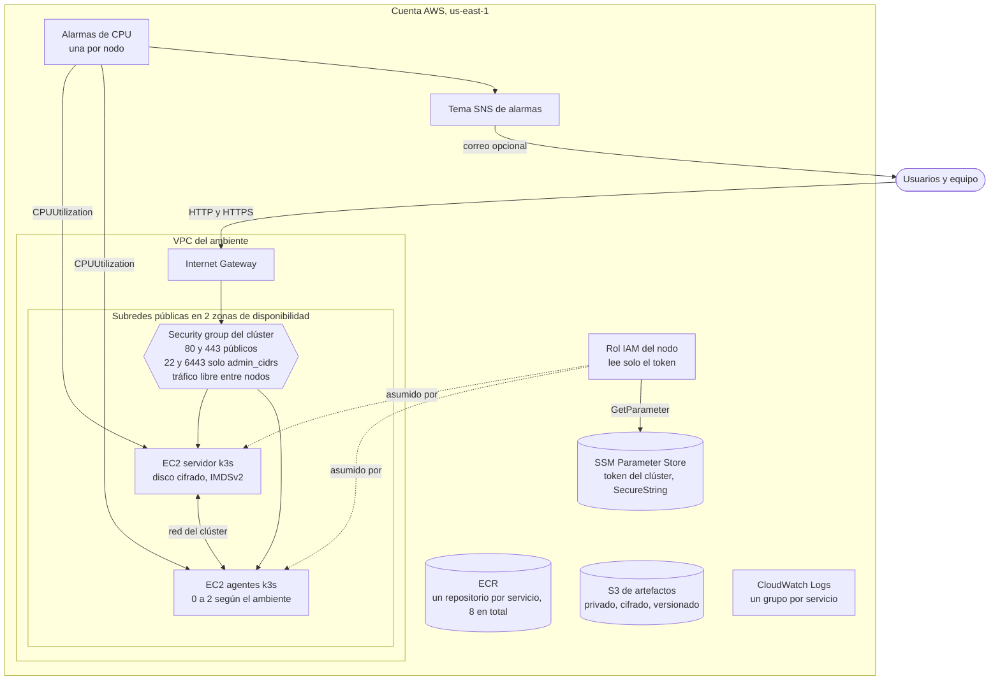
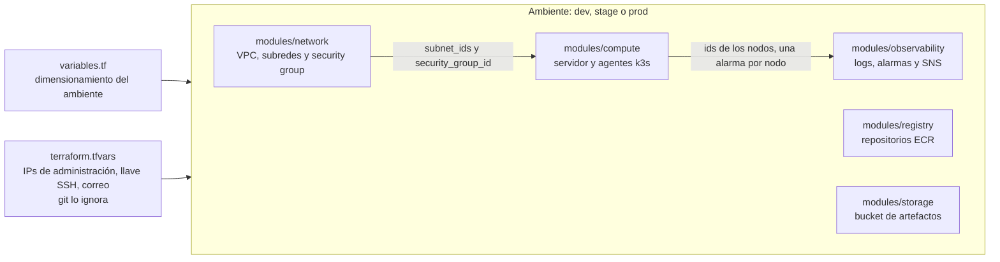
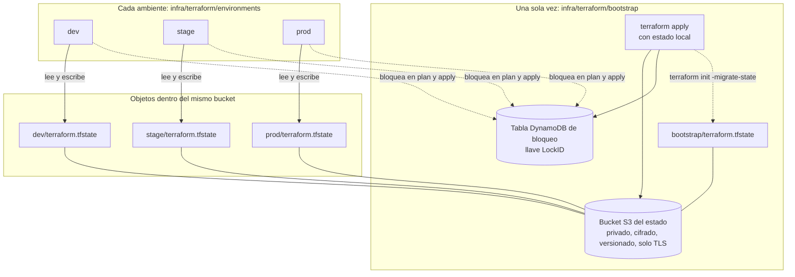
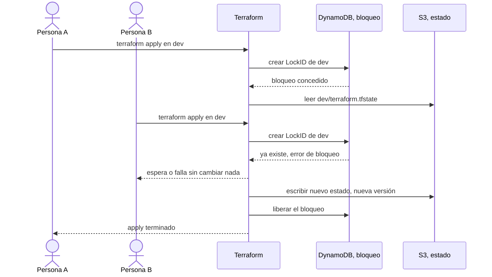
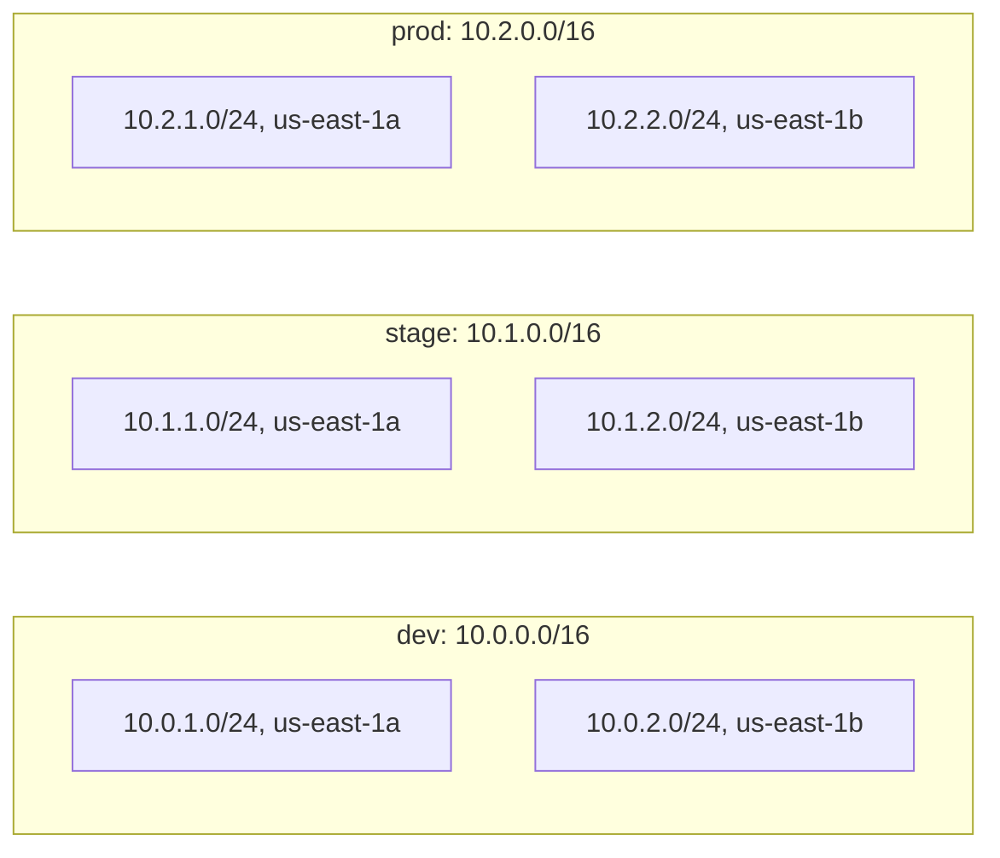

# Diagramas de la infraestructura como código (HU-10)

Diagramas de la infraestructura que describen los módulos y ambientes de
[`infra/terraform`](../terraform/README.md). Están escritos en Mermaid, así que
GitHub los dibuja directamente al abrir este archivo.

## 1. Arquitectura de un ambiente

Lo que crea cada ambiente (`dev`, `stage` o `prod`) en AWS. El número de agentes
cambia por ambiente: 0 en `dev`, 1 en `stage` y 2 en `prod`.

Los repositorios ECR, el bucket y los grupos de logs no dependen de la red: son
recursos regionales que el ambiente crea junto al clúster.

## 2. Módulos y ambientes

Cada ambiente es una configuración raíz que llama a los mismos cinco módulos.
Las flechas de un módulo a otro son datos que pasa el ambiente.

`registry` y `storage` no reciben datos de otros módulos. `observability` recibe
los identificadores de los nodos de `compute` y la lista de servicios.

## 3. Estado remoto

El backend se crea una vez con `bootstrap` y después lo usan los tres ambientes,
cada uno con su propia llave.

Secuencia de un `terraform apply` en un ambiente, y por qué dos personas no
pueden cambiar el mismo ambiente a la vez:

Cada escritura crea una versión nueva del objeto de estado, y las versiones
anteriores se conservan 90 días para poder deshacer un cambio equivocado.

## 4. Redes por ambiente

Los rangos no se solapan, de modo que los ambientes podrían conectarse entre sí
más adelante si hiciera falta.

## Referencias

- Módulos: [`infra/terraform/modules`](../terraform/modules)
- Backend remoto: [`infra/terraform/bootstrap`](../terraform/bootstrap/README.md)
- Ambientes: `infra/terraform/environments`
